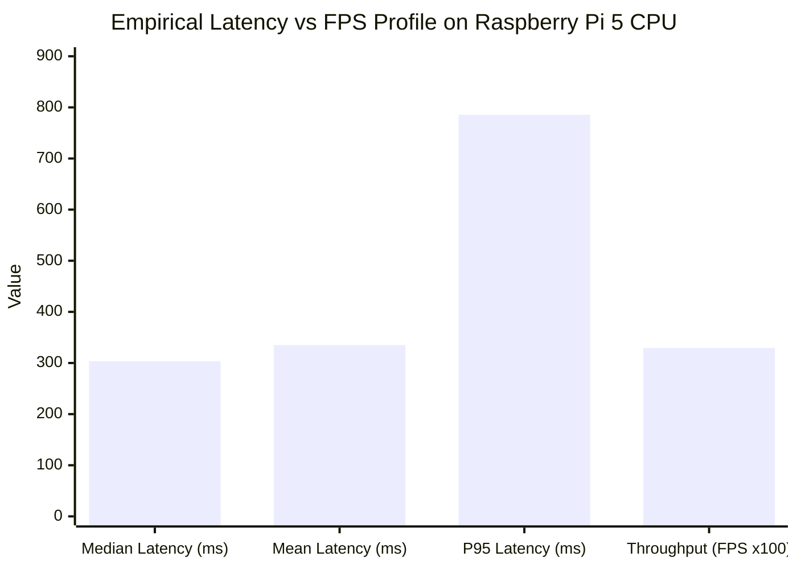

# Baseline Performance Report: Milestone 1 (M1.3)
**Student Name:** Sai Sanjay R (ID: S20)  
**Hardware Target:** Raspberry Pi 5 (Quad-Core Cortex-A76 @ 2.4 GHz, 4 GB RAM)  
**Operating System:** Debian GNU/Linux 13 (Trixie) aarch64  
**Runtime:** PyTorch 2.15.0+cpu on Python 3.13.5  

---

## 1. Executive Summary & Own Measurements
All metrics reported below were **empirically measured and logged on my physical Raspberry Pi 5 device** running single-batch ($B=1$) inference with the trained `best.pt` model ($640 \times 640$ resolution).

---

## 2. Empirical Benchmark Results Table

| Parameter | My Measured Value | Measurement Source / Hardware Interface |
|---|---|---|
| **Timed Benchmark Iterations** | **50 runs** | Single-batch ($B=1$) loop |
| **Warm-up Iterations** | **10 runs** | Unrecorded governor stabilization |
| **Median Inference Latency** | **303.54 ms** | `time.perf_counter()` forward pass |
| **Mean Inference Latency** | **335.08 ms** | Statistical mean across 50 runs |
| **P95 Latency (Tail Latency)** | **785.48 ms** | 95th percentile spike under thermal load |
| **Minimum Latency** | **189.23 ms** | Best observed single-frame pass |
| **Maximum Latency** | **941.60 ms** | Worst-case thermal throttle point |
| **Median Throughput (FPS)** | **3.29 FPS** | $1000 / \text{Latency}$ |
| **Mean Throughput (FPS)** | **3.46 FPS** | Average frames processed per second |
| **Mean CPU Utilization** | **82.88%** | Linux `psutil` CPU telemetry |
| **Average SoC Temperature** | **81.30°C** | `/sys/class/thermal/thermal_zone0/temp` |
| **Peak SoC Temperature** | **85.35°C** | Maximum recorded during 50-run test |
| **Average RAM Footprint** | **3,024.16 MB** | Resident memory during execution |

---

## 3. Evidence Files
- **Raw CSV Data**: `M1_Detect/results/baseline_speed_measurements.csv`
- **Performance Profile Graph**: `M1_Detect/evidence/m1_baseline_performance.png`
- **Benchmarking Tool**: `M1_Detect/benchmark.py`
