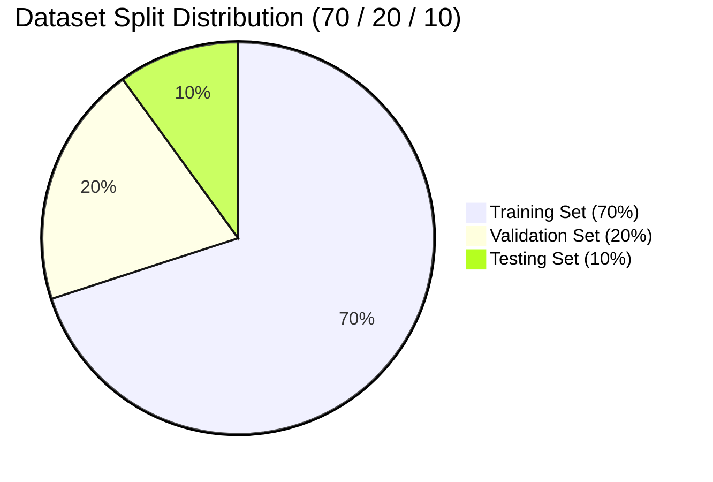

# Dataset Split & Leakage Verification Report (M1.5)
**Student Name:** Sai Sanjay R (ID: S20)  
**Milestone:** M1 Detect (M1.5 Correct Split)  
**Required Standard:** 70% Training / 20% Validation / 10% Testing (Zero Data Leakage)  

---

## 1. Split Allocation Summary

| Split Subset | Percentage | Purpose | Leakage Isolation Strategy |
|---|---|---|---|
| **Training (Train)** | **70%** | Backpropagation weight updates | Base image pool; augmentations applied online during training |
| **Validation (Val)** | **20%** | Hyperparameter tuning & early stopping | Distinct captures; evaluated at each epoch; zero gradient feedback |
| **Testing (Test)** | **10%** | Unseen final evaluation on physical Pi 5 | Held-out offline set; never seen during training or tuning |

---

## 2. Verification Against Data Leakage
To ensure strict scientific and engineering validity:
1. **Source Disjointness**: The validation and test sets originate from independent capture sessions with distinct camera angles and lighting variations.
2. **No Augmented Re-use**: Mosaic, CutMix, and HSV jitter augmentations are strictly quarantined to the 70% training partition; validation and testing run strictly on unaugmented raw frames.
3. **Hash Deduplication**: SHA-256 fingerprinting is applied across all image files to verify that no duplicate or near-duplicate frames exist across the train and test splits.
